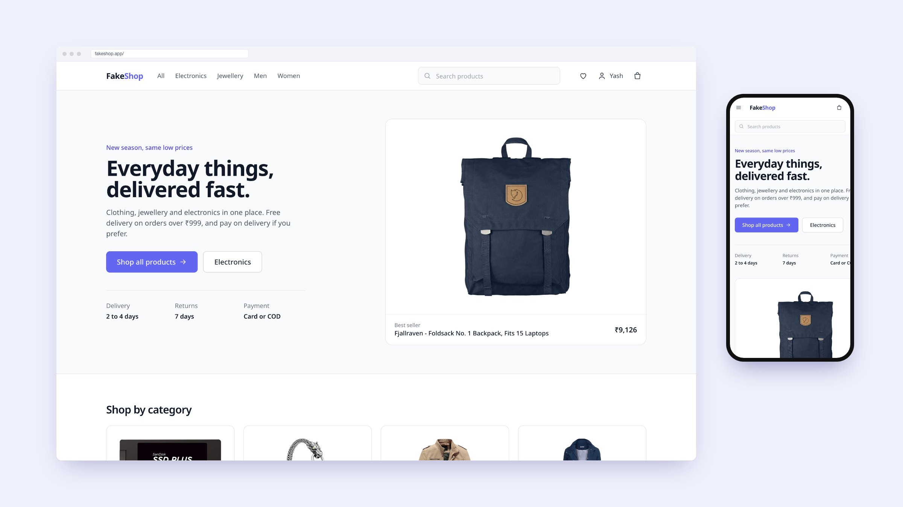
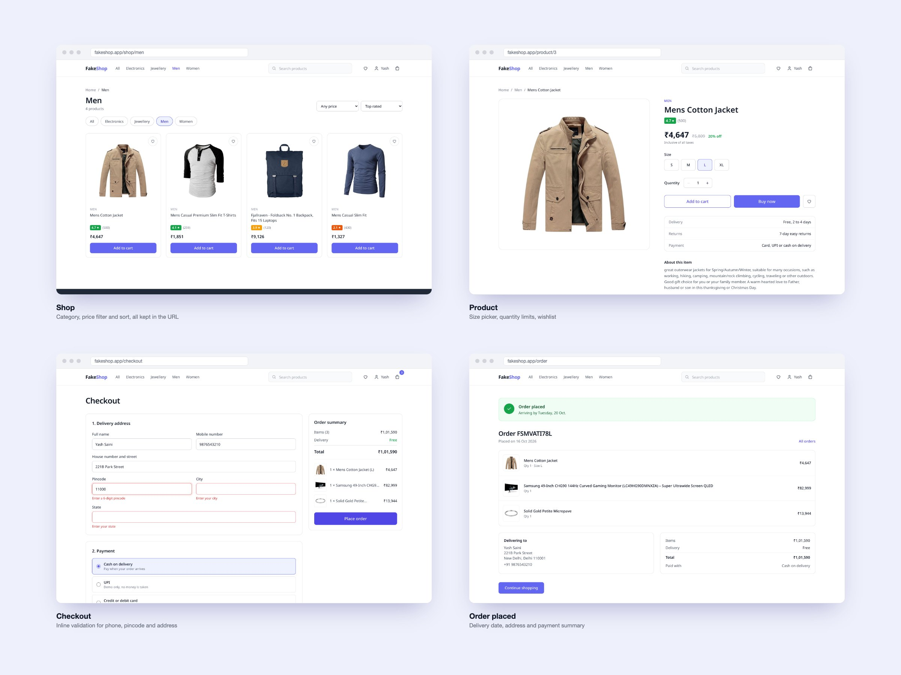
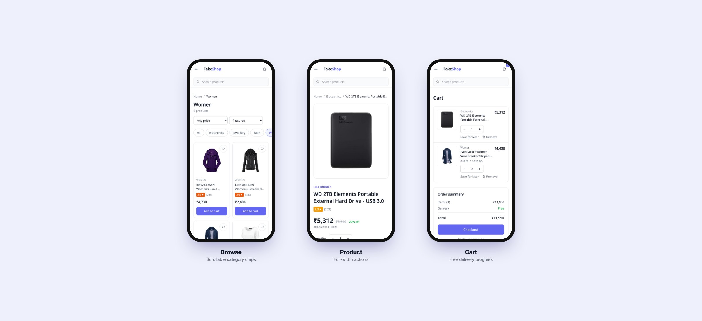

# FakeShop

An online store built with React and Tailwind CSS. Browse clothing, jewellery and electronics, save items to a wishlist, pick a size, and check out with a delivery address and payment method. Product data comes from the [Fake Store API](https://fakestoreapi.com).



## Screens





## Features

- Shop page with category, price filter, sort and search, all stored in the URL so results can be shared or bookmarked
- Product page with size picker for clothing, quantity limits and related products
- Cart that keeps each size as its own line, with save for later and a free delivery progress bar
- Wishlist with move to cart
- Sign up and sign in with inline validation; checkout and orders need an account
- Checkout with Indian phone and pincode validation, saved address and a choice of payment method
- Order confirmation and order history
- Cart, wishlist and account saved in localStorage and synced across tabs

## Edge cases handled

- Loading skeletons, an error state with retry, and a 10 second request timeout
- Product ids that don't exist, invalid ids and unknown categories show a 404 page
- Empty cart, wishlist, orders and search results each have their own empty state
- Opening checkout with an empty cart sends you back to the cart
- Corrupted or old localStorage data is ignored instead of crashing the app
- Broken product images fall back to a placeholder
- The place order button can't be pressed twice

## Tech stack

React 18 · React Router 6 · Tailwind CSS · Context API · Fake Store API

## Project structure

```
src/
├── pages/    # Home, Shop, Product, Cart, Wishlist, Auth, Checkout, Account
├── ui/       # Header, Footer, ProductCard, form fields, icons, empty and error states
├── store/    # cart, wishlist, account and orders state
└── lib/      # API client, fetch hook, price formatting
```

## Run locally

```bash
npm install
npm start
```

This is a frontend-only demo. Accounts and orders are saved in your browser, and no payment is taken.
